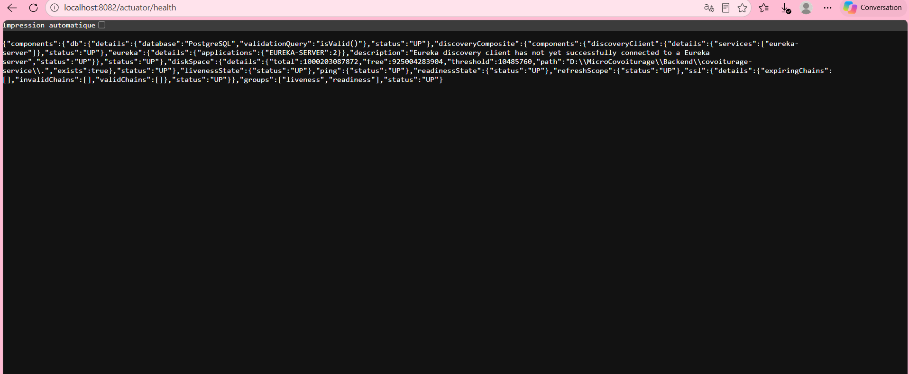
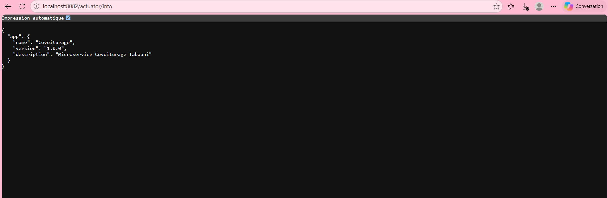
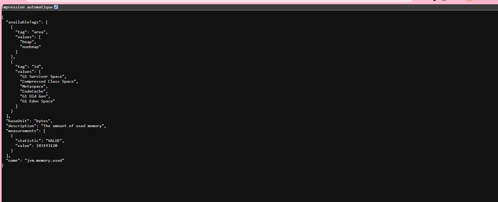
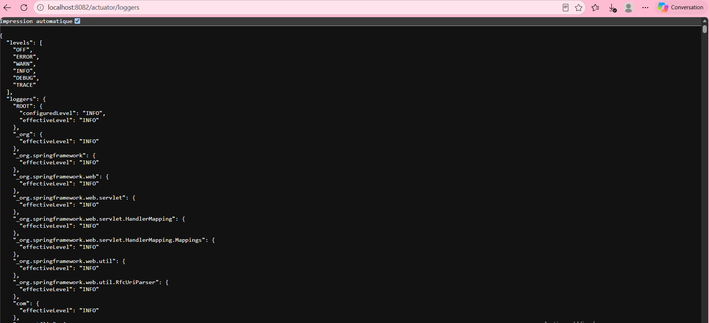

# tabaani-4SSA13-G3

## Structure
- **Backend/** — Microservices
- **Frontend/** — Client application
- **Documentation/** - Project documentation

## Tech Stack

### Backend
- Language: <e.g. Java / Node.js / Python>
- Framework: <e.g. Spring Boot / Express / FastAPI>
- Databases: <e.g. PostgreSQL, MongoDB>
- Communication: <e.g. REST, gRPC, message broker>

### Frontend
- Framework: <e.g. React / Angular / Vue>

### Tools
- Version control: Git + GitHub
- Containerization: <e.g. Docker, Docker Compose>
- API testing: <e.g. Postman>
- CI/CD: <e.g. GitHub Actions> (optional)

## Team
- Lina Rouabeh
- Ibtissem Sghaier
- Salmen Torkhani
- Mohamed Gharsa
- Yassine Belhout
- Anis Othmani

## Eureka et Covoiturage — lancement local

Prérequis : Java 17, PostgreSQL et les noms suivants dans le fichier `hosts` de Windows :

`127.0.0.1 peer1 peer2`

Dans `eureka-server`, lancer deux instances :

- **peer1** : port 8761.
- **peer2** : port 8762.

Dans `Backend/covoiturage-service`, configurer `DB_PASSWORD`, puis lancer :

`.\mvnw.cmd spring-boot:run`

Le microservice Covoiturage fonctionne sur le port **8082**.

### Vérifications

- Eureka peer1 : http://localhost:8761
- Eureka peer2 : http://localhost:8762
- Santé : http://localhost:8082/actuator/health
- Informations : http://localhost:8082/actuator/info
- Métriques : http://localhost:8082/actuator/metrics
- Logs : http://localhost:8082/actuator/loggers

Les deux dashboards affichent **EUREKA-SERVER UP (2)** et **COVOITURAGE-SERVICE UP (1)**.

### Captures Eureka

## Captures Actuator

### Santé du microservice

### Informations de l'application

### Métriques

### Niveau des logs

