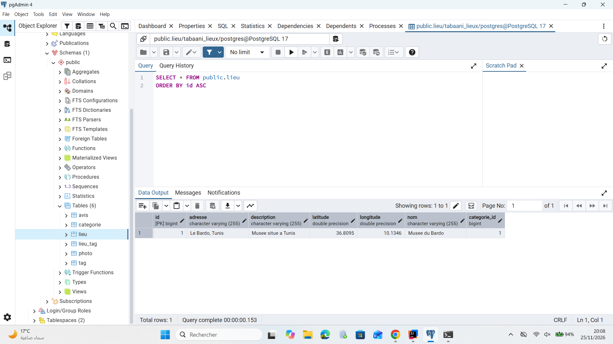
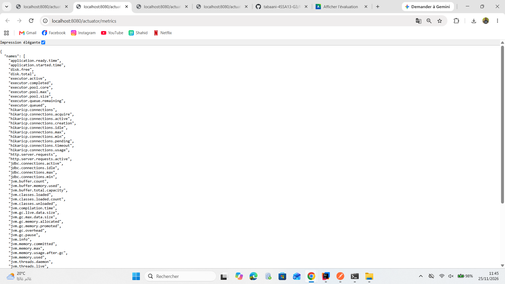

# Tabaani — 4SSA13 — Groupe 3

Application d’organisation de voyages basée sur une architecture microservices.

## Structure

- **Backend/** : microservices.
- **Frontend/** : application cliente.
- **Documentation/** : documentation, diagrammes et captures.

## Équipe

- Lina Rouabeh
- Ibtissem Sghaier
- Salmen Torkhani
- Mohamed Gharsa
- Yassine Belhout
- Anis Othmani

## Microservice Lieux & Découverte

Responsable : **Ibtissem Sghaier**.

Emplacement : `Backend/lieux-decouverte-service`.

### Technologies

- Java 17 et Spring Boot.
- Maven.
- Spring Data JPA.
- PostgreSQL 17.
- Spring Cloud Netflix Eureka.
- Spring Boot Actuator.
- API REST.
- Postman et PowerShell pour les tests.
- Git et GitHub.

### Entités et fonctionnalités

Entités : Lieu, Categorie, Tag, Photo et Avis.

Associations :
- Un lieu appartient à une catégorie.
- Les lieux et les tags sont associés en Many-to-Many.
- Chaque photo et chaque avis sont associés à un lieu.

Fonctionnalités réalisées :
- CRUD des lieux avec validation des données.
- Ajout et consultation des catégories.
- Enregistrement dans Eureka.
- Deux instances du microservice.
- Supervision avec Actuator.

## Configuration PostgreSQL

### Prérequis

Installer PostgreSQL 17 et démarrer le serveur sur le port **5432**.

Dans pgAdmin, créer une base :

- Nom : `tabaani_lieux`.
- Propriétaire : `postgres`.

### Connexion du microservice

La configuration utilise :

```properties
spring.datasource.url=jdbc:postgresql://localhost:5432/tabaani_lieux
spring.datasource.username=postgres
spring.datasource.password=${DB_PASSWORD}
spring.jpa.hibernate.ddl-auto=update
```

Dans chacune des deux configurations IntelliJ du microservice Lieux :

1. Ouvrir **Edit Configurations**.
2. Afficher **Environment variables** via **Modify options**.
3. Ajouter la variable `DB_PASSWORD` avec le mot de passe PostgreSQL local.
4. Enregistrer la configuration.

Le mot de passe ne doit pas être enregistré dans le dépôt Git.

Les deux instances Lieux utilisent la même base PostgreSQL.
Les données sont partagées et conservées après le redémarrage des applications.

Hibernate crée et met à jour les tables avec `ddl-auto=update`.

PostGIS n’est pas encore installé.

## Lancement local avec Eureka

### Prérequis

- JDK 17.
- IntelliJ IDEA.
- PostgreSQL démarré.
- Base `tabaani_lieux` créée.
- Variable `DB_PASSWORD` configurée pour chaque instance Lieux.

### Configuration du fichier hosts

Sous Windows, ouvrir le Bloc-notes en tant qu’administrateur, puis ouvrir :

```text
C:\Windows\System32\drivers\etc\hosts
```

Ajouter cette ligne en conservant le contenu existant :

```text
127.0.0.1 peer1 peer2
```

Enregistrer le fichier sans ajouter d’extension `.txt`.

### Serveurs Eureka

Ouvrir `Backend/eureka-server` et charger le projet Maven.

Créer deux configurations pour `EurekaServerApplication` :

| Configuration | Active profiles | Port |
| --- | --- | --- |
| Eureka peer1 | peer1 | 8761 |
| Eureka peer2 | peer2 | 8762 |

### Instances Lieux

Ouvrir `Backend/lieux-decouverte-service` et charger le projet Maven.

Créer deux configurations pour `LieuxDecouverteServiceApplication` :

| Configuration | Program arguments | Port |
| --- | --- | --- |
| Lieux instance 1 | Aucun | 8080 |
| Lieux instance 2 | --server.port=8090 | 8090 |

Conserver `server.port=8080` dans `application.properties`.
L’argument de la deuxième configuration remplace cette valeur pour son lancement.

### Ordre de lancement

1. Démarrer PostgreSQL.
2. Lancer Eureka peer1.
3. Lancer Eureka peer2.
4. Lancer Lieux instance 1.
5. Lancer Lieux instance 2.

Garder les quatre applications Java et PostgreSQL en marche simultanément.

## Vérifications Eureka

- [Dashboard peer1](http://peer1:8761)
- [Dashboard peer2](http://peer2:8762)

Après le démarrage et la propagation des enregistrements, les deux dashboards doivent afficher :

| Application | Statut attendu | Ports |
| --- | --- | --- |
| EUREKA-SERVER | UP (2) | 8761 et 8762 |
| LIEUX-DECOUVERTE-SERVICE | UP (2) | 8080 et 8090 |

Dans **DS Replicas**, peer1 référence peer2 et peer2 référence peer1.

### Captures Eureka


## API REST

URL de base : `http://localhost:8080`.

Les mêmes routes sont disponibles sur le port `8090`.

| Méthode | Route | Fonction |
| --- | --- | --- |
| POST | /api/categories | Ajouter une catégorie |
| GET | /api/categories | Lister les catégories |
| POST | /api/lieux | Ajouter un lieu |
| GET | /api/lieux | Lister les lieux |
| GET | /api/lieux/{id} | Consulter un lieu |
| PUT | /api/lieux/{id} | Modifier un lieu |
| DELETE | /api/lieux/{id} | Supprimer un lieu |

## Vérifications PostgreSQL réalisées

- Connexion PostgreSQL : **UP** dans Actuator.
- Création d’une catégorie via l’instance **8080**.
- Consultation de cette catégorie via l’instance **8090**.
- Conservation de la catégorie après redémarrage des instances.
- Création d’un lieu associé à une catégorie.
- Vérification du lieu et de `categorie_id` dans pgAdmin.

### Données enregistrées dans PostgreSQL



## Supervision Actuator

| Endpoint | Fonction |
| --- | --- |
| /actuator/health | Santé du microservice et de ses composants |
| /actuator/info | Informations sur l’application |
| /actuator/metrics | Liste des métriques |
| /actuator/metrics/jvm.memory.used | Mémoire utilisée par la JVM |
| /actuator/metrics/http.server.requests | Statistiques des requêtes HTTP |
| /actuator/loggers/tn.esprit.tabaani.lieux | Consultation et modification du niveau des logs |

### Liens

- [Santé — 8080](http://localhost:8080/actuator/health)
- [Santé — 8090](http://localhost:8090/actuator/health)
- [Informations](http://localhost:8080/actuator/info)
- [Métriques](http://localhost:8080/actuator/metrics)
- [Logs](http://localhost:8080/actuator/loggers/tn.esprit.tabaani.lieux)

### Captures Actuator

Les captures ci-dessous ont été prises pendant les premiers essais avec H2, avant le passage à PostgreSQL.

#### Santé du microservice


#### Informations de l’application


#### Métriques



#### Niveau des logs


## Intégration du groupe

Cette documentation présente la configuration locale de Lieux & Découverte et des deux serveurs Eureka.

L’intégration complète du groupe reste à vérifier :
- Enregistrement simultané de tous les microservices.
- Microservice développé avec une autre technologie.
- Deux instances d’un deuxième microservice fortement sollicité.
- Fonctionnement sur les machines des membres.

Le travail présenté est disponible sur la branche `Lieux-decouverte`.