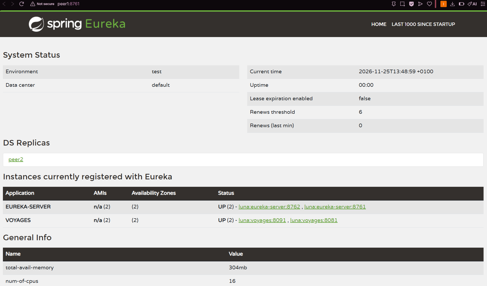
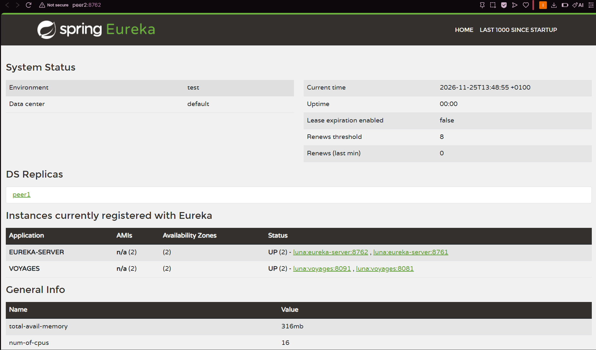
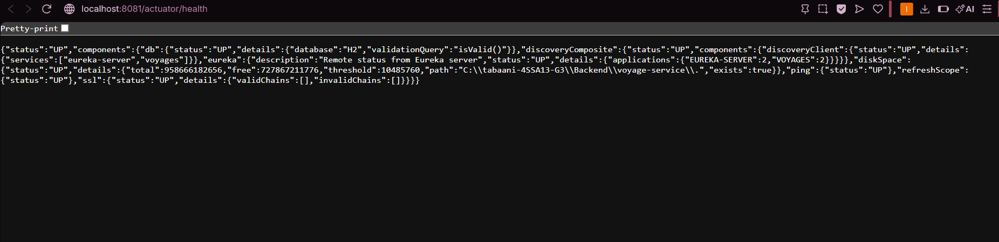
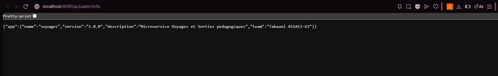
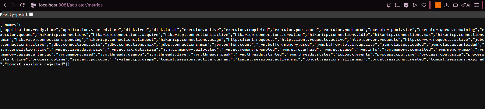
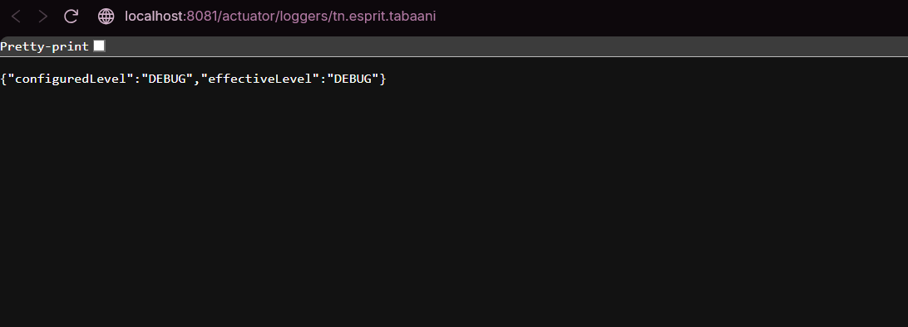

# tabaani-4SSA13-G3

Tabaani — collaborative road-trip and educational outings platform, built as a microservices architecture (AWD module, 4SSA13 – Group 3).

## Structure
- **Backend/** — Microservices
  - `eureka-server/` — Service discovery (Eureka Server, port 8761)
  - `voyages-service/` — Voyages & Sorties pédagogiques (port 8081)
- **Frontend/** — Client application
- **Documentation/** — Project documentation (presentation, diagrams)

## Tech Stack

### Backend
- Language: Java 17
- Framework: Spring Boot 3.5, Spring Cloud 2025.0 (Eureka, Gateway, Config Server, OpenFeign)
- Databases: PostgreSQL, MySQL, MongoDB (one database per service) — H2 for early development
- Communication: REST (synchronous, OpenFeign) + RabbitMQ (asynchronous events)
- Security: Keycloak (JWT validated at the API Gateway)
- Observability: Spring Boot Actuator

### Frontend
- Framework: Angular / React (to be confirmed)

### Tools
- Version control: Git + GitHub
- Containerization: Docker, Docker Compose
- API testing: Postman, Swagger

## How to run (local)
Start the services in this order:

1. **Eureka Server**
   ```bash
   cd Backend/eureka-server
   ./mvnw spring-boot:run
   ```
   Dashboard: http://localhost:8761

2. **Voyages service**
   ```bash
   cd Backend/voyages-service
   ./mvnw spring-boot:run
   ```
   Second instance (load test): `./mvnw spring-boot:run "-Dspring-boot.run.arguments=--server.port=8091"`

---

## Atelier 1 — Eureka Server

Every microservice registers with the same Eureka server and is found by its name (`spring.application.name`) instead of a hard-coded address.

| Microservice | Technology | Port | Eureka name |
|---|---|---|---|
| Eureka Server | Spring Boot | 8761 | – |
| Voyages | Spring Boot + H2 | 8081 / 8091 | VOYAGES |

**VOYAGES registered with Eureka (1 instance):**



**Two instances of VOYAGES (ports 8081 and 8091):**



> The red "EMERGENCY" message is Eureka's *self-preservation mode*: with few instances, it receives fewer heartbeats than its threshold and keeps instances registered as a precaution. This is expected in development.

## Atelier 2 — Observability with Spring Boot Actuator

Exposed endpoints: `health`, `info`, `metrics`, `loggers`. The health status is published to Eureka (`eureka.client.healthcheck.enabled=true`).

**`/actuator/health`** — overall status UP, computed from its components (`db` H2, `diskSpace`, `discoveryComposite`, `ping`…):



**`/actuator/info`:**



**`/actuator/metrics/http.server.requests`:**



- **COUNT:** 13 HTTP requests processed.
- **MAX:** 0.149 s (≈ 149 ms) for the slowest request.
- **`?tag=status:200`:** keeps only requests that ended with HTTP 200 → also 13, total time 0.306 s (≈ 23 ms on average). All requests succeeded (`outcome: SUCCESS`).

**`/actuator/loggers`** — log level changed from INFO to DEBUG at runtime, without restarting:



> Note: the "stop the database → service DOWN" test requires a real database server. The Voyages service currently uses H2 in memory; this test will apply once it moves to PostgreSQL.

---

## Team
- Lina Rouabeh - Voyages & Sorties pédagogiques
- Ibtissem Sghaier
- Salmen Torkhani
- Mohamed Gharsa
- Yassine Belhout
- Anis Othmani