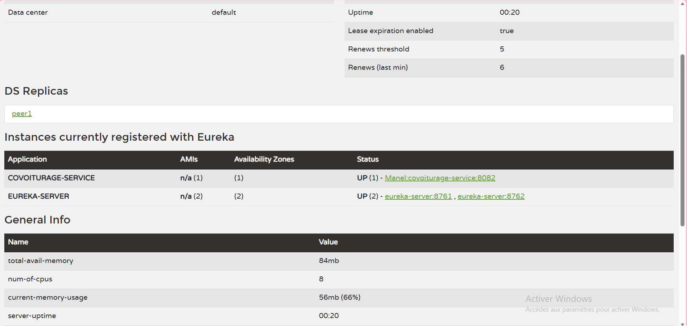
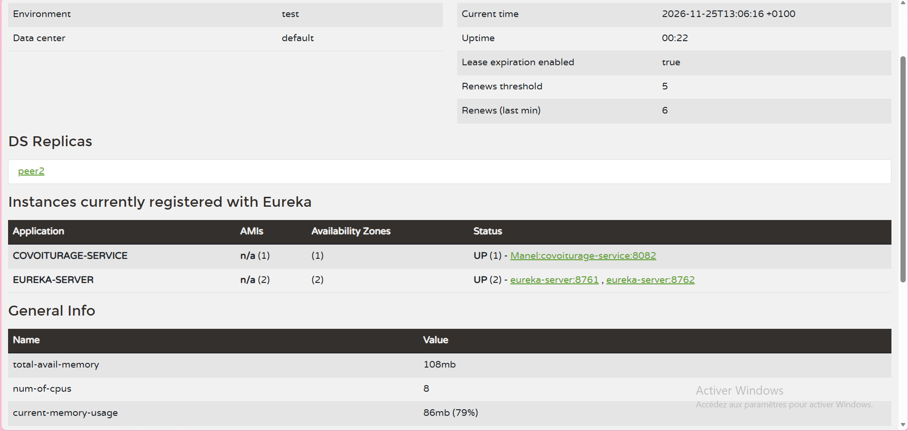
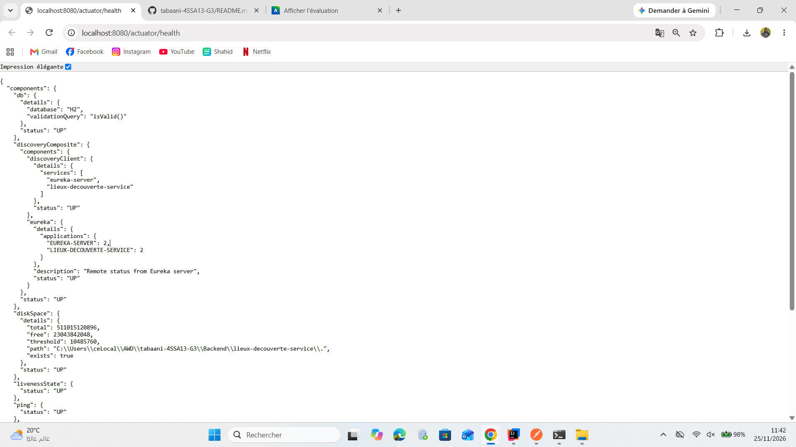
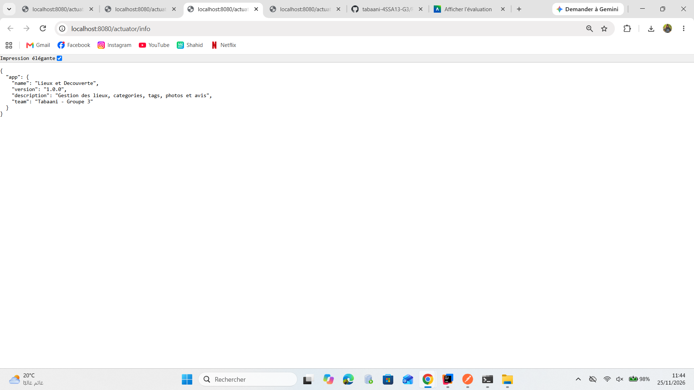
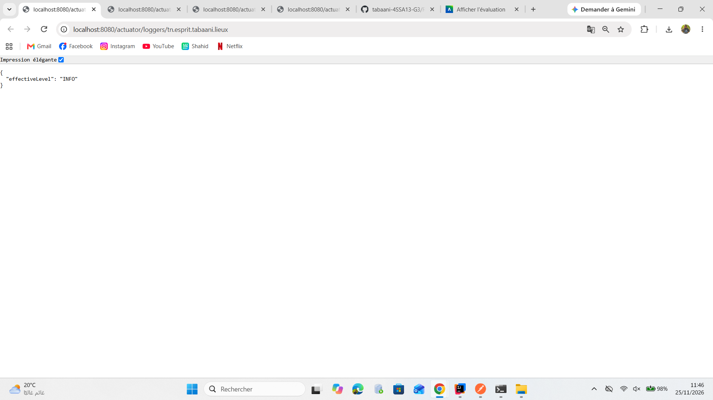

# tabaani-4SSA13-G3

## Structure

* **Backend/** — Microservices
* **Frontend/** — Client application
* **Documentation/** - Project documentation

## Tech Stack

### Backend

* Language: <e.g. Java / Node.js / Python>
* Framework: <e.g. Spring Boot / Express / FastAPI>
* Databases: <e.g. PostgreSQL, MongoDB>
* Communication: <e.g. REST, gRPC, message broker>

### Frontend

* Framework: <e.g. React / Angular / Vue>

### Tools

* Version control: Git + GitHub
* Containerization: <e.g. Docker, Docker Compose>
* API testing: <e.g. Postman>
* CI/CD: <e.g. GitHub Actions> (optional)

## Team

* Lina Rouabeh
* Ibtissem Sghaier
* Salmen Torkhani
* Mohamed Gharsa
* Yassine Belhout
* Anis Othmani


## Eureka et Lieux & Découverte — lancement local


Prérequis : Java 17 et les noms suivants dans le fichier hosts de Windows :


```text

127.0.0.1 peer1 peer2

```


Dans `Backend/eureka-server`, lancer deux configurations IntelliJ :

- Profil actif `peer1` : port 8761.

- Profil actif `peer2` : port 8762.


Dans `Backend/lieux-decouverte-service`, lancer deux configurations :

- Première instance : port 8080.

- Deuxième instance : argument `--server.port=8090`.


Les quatre applications doivent rester lancées simultanément.

Pour ces essais, chaque instance Lieux utilise sa propre base H2 en mémoire.


### Vérifications


- Eureka peer1 : http://peer1:8761

- Eureka peer2 : http://peer2:8762

- Santé Lieux : http://localhost:8080/actuator/health

- Informations : http://localhost:8080/actuator/info

- Métriques : http://localhost:8080/actuator/metrics


Les deux dashboards affichent EUREKA-SERVER UP (2) et

LIEUX-DECOUVERTE-SERVICE UP (2).


### Captures







## Captures Actuator

### Santé du microservice


### Informations de l’application


### Métriques


### Niveau des logs
